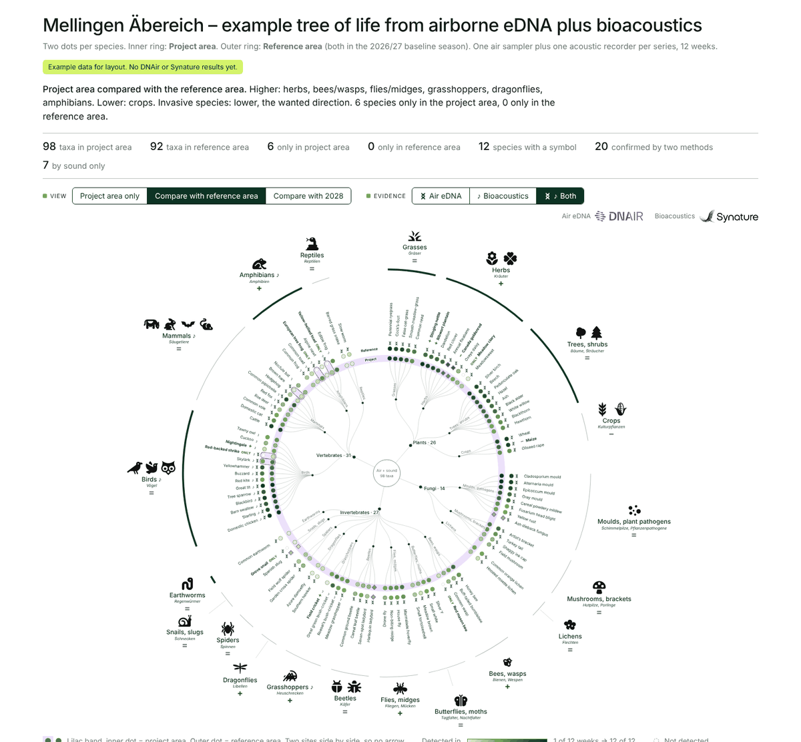

# NFA evidence tree

**Live page: https://naturefinanceaccelerator.github.io/nfa-evidence-tree/**

Display prototype for species evidence from airborne eDNA plus bioacoustics, shown as a tree of life for the Mellingen Äbereich pilot.

> **Example data only.** Every species, detection value, flag, threshold on this page is invented to test the layout. No results from DNAir or Synature are shown.

## What it is

One self-contained HTML page (`index.html`). Open it in a browser, no install, no server.

The page answers one question for a site: which species does the evidence show, how often, by which method.

## How to read it

- **Tree.** Four branches (plants, fungi, invertebrates, vertebrates), 20 practical groups, one dot per species.
- **Dot colour.** Weeks with at least one detection, out of 12. Never read counts.
- **Silhouettes.** One block per group on the outer ring, English name with German name below.
- **Thick arc.** Group belongs to the Mellingen measurement basket.
- **Pop-up.** Hover a dot or a name: English, German, French, Italian, Latin name plus the detection values.

## Views

| Switch | Options | What changes |
|---|---|---|
| View | Project area only | One dot per species. The start view. |
| | Compare with reference area | Two dots per species. Lilac band = project area, outer ring = reference area. |
| | Compare with 2028 | Two dots per species with an arrow from baseline 2026/27 to 2028. |
| Evidence | Air eDNA | Detections from the air sampler. The start view. |
| | Bioacoustics | Detections from the acoustic recorder. Groups sound cannot cover turn pale. |
| | Both | Either method. A DNA strand marks air, a note marks sound, both marks mean two methods agree. |

## Change symbols in the comparison views

- `+` 3–4 weeks more, `++` 5–6, `+++` 7 or more. Same scale with `−`.
- No symbol within 2 weeks: with one sampler per site that is noise.
- `NEW` / `LOST` over time, `ONLY` / `ABSENT` against the reference area.
- Green = wanted direction, brown with `!` = unwanted, grey = neutral (crops, livestock, common moulds). For invasive species plus plant pathogens, less is the wanted direction.
- Group verdicts use the group mean: `+` from 1 week, `++` from 2, `+++` from 3.

All thresholds are placeholders until replicate variance from real samples is available.

## Open points before real data

1. Source area per air sampler, distance between project plus reference sampler.
2. Replicate variance, to set the noise band from data.
3. Week-by-week records from both methods, so "Both" counts weeks in which either method detected a species.
4. Confidence threshold plus manual check share for the acoustic classifier.
5. Flags from the Swiss Red Lists plus the federal list of invasive alien species.
6. French plus Italian names checked against info fauna / Info Flora.
7. Species-accurate silhouettes (PhyloPic) in place of the generic icons.

## Files

- `index.html` – the page, everything inline.
- `screenshot.png` – the picture above.
- `snapshots/` – earlier stages, each a working page: single sampler, two rings, three views, bioacoustics, the version before the homepage colours.
- The working copy lives in the Google Drive folder "NFA Evidence Tree". "Sync to GitHub.bat" in that folder mirrors it to this repo.
- `NOTICE.md` – third-party material.

## Status

First overview for the NFA team, 25 November 2026. Contact: Matthias Häni, Chief Scientist, NFA Foundation.
